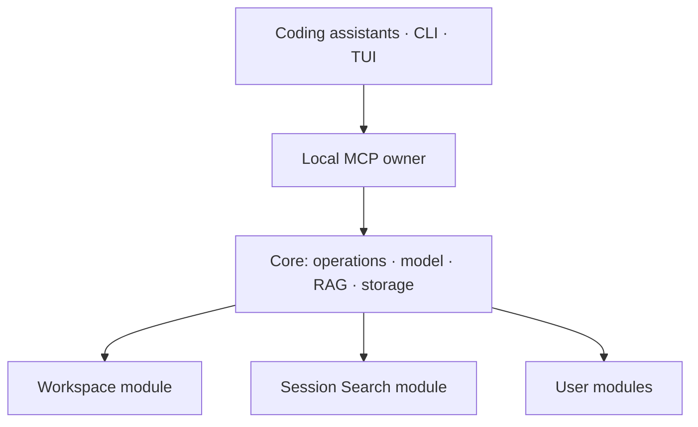

<p align="center">
  
</p>

# Contextopus

**A modular system for reusing and improving context.** Prepare context once,
apply it across tasks and tools, and refine it as you work.

Context can include knowledge, instructions, skills, reusable commands, agent
roles and session history. Contextopus helps people and agents find relevant
material, read it and adapt it to the task. Reuse reduces repeated research,
generation and explanations from the user. Saved context can be corrected,
connected and gradually improved.

**Core provides the shared foundation:** storage, indexing, semantic search,
filtering, settings and one MCP service for connected agents. Each module defines
its own materials and ways of working with them. Modules share an embedding model
and search infrastructure while keeping separate databases, so a new module does
not need to build its own retrieval system.

- **Workspace organizes project work.** Agents use current knowledge, goals and
  rules, carry out tasks, verify results and update the connected context. Each
  task can build on decisions and findings from earlier work.
- **Session Search makes past sessions reusable.** Find decisions, commands,
  errors and explanations with links to the original conversation. Recover how
  work was done, check where a decision came from and use the findings in a new
  task.

The same foundation can support modules for managing skills, selecting agent
roles and finding reusable commands. Choose the modules that fit your work.

<p align="center">
  <a href="#install-contextopus"><strong>Install Contextopus</strong></a> ·
  <a href="#choose-your-modules">Ecosystem</a> ·
  <a href="#connect-a-coding-assistant">Coding assistants</a> ·
  <a href="docs/modules.md">Build a module</a> ·
  <a href="docs/development.md">Development</a>
</p>

> **Version 1.5.0** distributes Core and optional modules independently.
> [Release downloads](https://github.com/pikiby/contextopus-core/releases/tag/v1.5.0) · [Installation guide](distribution/README.md).

## Choose your modules

### Core

**One foundation across tools.** Connect your coding assistants and terminal to
one local context service. Modules share a model and retrieval infrastructure,
giving project knowledge and session history a common route into your tools.
Choose the modules that fit your work and use them across clients.

[Core repository](https://github.com/pikiby/contextopus-core) ·
[Architecture](docs/architecture.md) · [Build a module](docs/modules.md)

### Workspace

**Make project knowledge improve with the work.** Workspace gives the agent a
procedure for building and maintaining a growing vector knowledge base: find
relevant knowledge, work under your rules, verify the result, then update,
merge and link what belongs in the project's memory.

Knowledge stays in readable, linked Markdown and is indexed for semantic
search. Updates follow your review and approval policies. As verified findings
are corrected and connected, new tasks can use a better account of what is
known and what still needs checking.

[Workspace repository and guide](https://github.com/pikiby/contextopus-workspace#readme)

### Session Search

**Recover how a problem was solved.** Search real Codex conversation transcripts
for decisions, useful commands, errors and explanations. Follow a match back to
its source session and surrounding messages to check the details before reusing
them in a new task.

[Session Search repository and guide](https://github.com/pikiby/contextopus-session-search#readme)

<a id="start-from-source"></a>

## Install Contextopus

### Everything together

The starter ZIP combines **Core + Workspace + Session Search**. Extract it,
open the `contextopus` folder in a terminal, and run:

**Linux or macOS**

```sh
sh install.sh
```

**Windows PowerShell**

```powershell
.\install.ps1
```

Choose a data folder and optional coding assistants, review the plan and confirm.
The installer prepares both modules and local CPU embeddings. Git and internet
access are required for dependencies and model downloads.

Download [contextopus-starter-1.5.0.zip](https://github.com/pikiby/contextopus-core/releases/download/v1.5.0/contextopus-starter-1.5.0.zip) and verify its checksum.
[Prerequisites and options](distribution/README.md).

### Choose only what you need

Download [Core 1.5.0](https://github.com/pikiby/contextopus-core/releases/download/v1.5.0/contextopus-core-1.5.0.zip),
extract it, and run the same `install.sh` or `install.ps1`. This smaller bundle
installs Core with local CPU embeddings and your choice of clients.

Add [Workspace](https://github.com/pikiby/contextopus-workspace#readme) or
[Session Search](https://github.com/pikiby/contextopus-session-search#readme)
later through its installer, or install a verified module ZIP directly:

```console
contextopus modules install MODULE_ID --source /path/to/module.zip
```

The full starter also supports `--module none` for Core only, or repeated
`--module ID` flags for a subset. [Source installation and model setup](docs/development.md#install-from-source).

## Connect a coding assistant

**The starter configures the clients you select.** For an existing installation,
use the command for your client below. Each command prints its preview and applies
the configuration and available skills. To review without writing, omit `--apply`.

<details>
<summary>Codex</summary>

```console
contextopus integrate codex --user --apply
```

</details>

<details>
<summary>Claude Code</summary>

```console
contextopus integrate claude-code --user --apply
```

</details>

<details>
<summary>OpenCode</summary>

```console
contextopus integrate opencode --user --apply
```

</details>

<details>
<summary>Crush</summary>

```console
contextopus integrate crush --user --apply
```

</details>

<details>
<summary>Hermes</summary>

```console
contextopus integrate hermes --user --apply
```

</details>

Reload the client, then ask:

> Use Contextopus to list my installed modules and read the guide for getting started.

Keep one data root across clients. If you add a module later, repeat integration
to deliver its skills. User-edited skills are protected. Hermes profiles and
project-scoped connections are covered in the
[connection guide](docs/integrations.md) and
[Hermes guide](docs/integrations/hermes.md).

## How the pieces fit



One Core process owns shared resources. Every module owns its domain schema and
data; SQL lives in `core/storage/modules/MODULE_ID.sqlite3`. Replaceable module
code stays separate from mutable data and configuration. Discovery reads manifests;
explicit install/update actions prepare dependencies and migrations. Disable
removes the contribution while retaining data.

The TUI exposes status, model/search settings and module controls.
[Architecture](docs/architecture.md) · [Module lifecycle and SDK](docs/modules.md) ·
[Search selection](docs/search-selection.md).

## Development and documentation

Core builds and tests from this repository alone. Module repositories own their
module tests and artifacts; cross-repository checks take explicit Core/module
inputs. Core's wheel and client ZIPs contain the `m` skill only.

- [Build, tests and installed-wheel verification](docs/development.md)
- [Architecture and data layout](docs/architecture.md)
- [Module contract and examples](docs/modules.md)
- [Native integrations](docs/integrations.md)
- [Search evidence](docs/search-analysis.md)
- [Published release history](CHANGELOG.md)

The configured CI matrix targets Python 3.12/3.13 on Linux, macOS and Windows.
A passing source test does not establish a published artifact, an updated live
installation or compatibility with every client version.

## License

[Apache License 2.0](LICENSE). See [NOTICE](NOTICE) for attribution.
