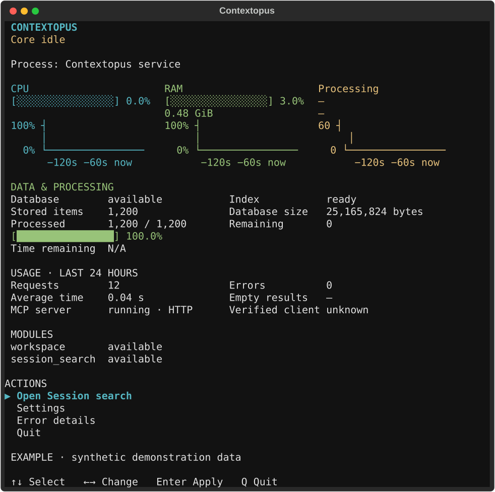
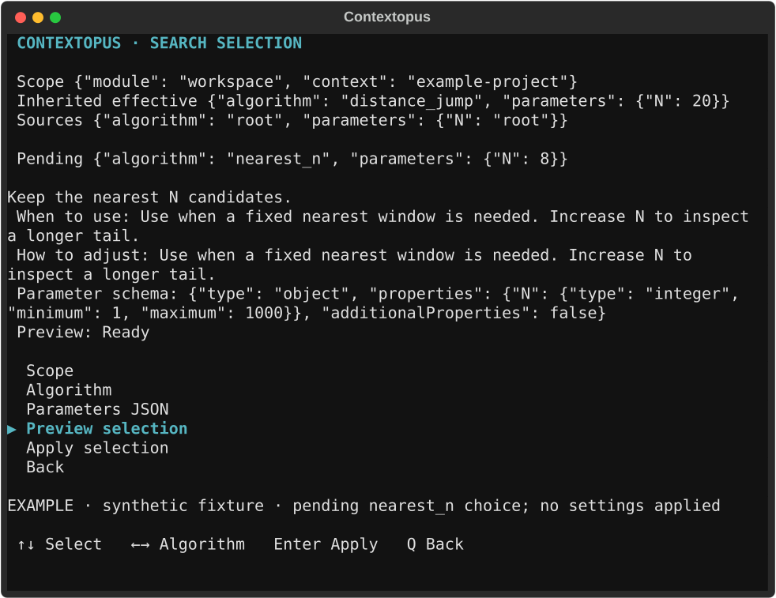

<p align="center">
  
</p>

# Contextopus

Persistent context for people and coding agents. Keep project knowledge, working instructions and unfinished work outside a chat, then use the same context from a terminal or your coding assistant.

Contextopus is a standalone Python application with a shared Core, a Workspace module, a terminal interface and an MCP service. Coding-client integrations connect to that service and expose short skills.

**This checkout prepares Contextopus 1.3.1:** compact material retrieval, three MCP tools (`guide`, `read`, `write`), correct document-level selection across all builtin algorithms, Obsidian navigation, separate machine settings and one-action module installation with packaged database migrations. Package build, publication, live migration and actual client adoption are separate checks. [1.3.1 patch and upgrade instructions](docs/releases/1.3.1.md). The patch prioritizes a selected root’s own vault boundary when an ancestor also contains `.obsidian`.



Actual Textual render with clearly marked synthetic example data. [Keyboard settings demo](docs/media/tui/settings-demo.gif) · [Narrow terminal](docs/media/tui/main-narrow.png) · [Capture method and limits](docs/media/tui/README.md).



The existing 1.2 search-selection capture shows inherited values, a pending algorithm choice and revision preview. [Modules screen](docs/media/tui/modules-1.2-wide.png). Both captures render the actual TUI with explicitly synthetic fixtures; they do not show a live installation.

## Use it

| Scenario | Entry |
|---|---|
| Continue project work with persistent knowledge | `w` skill |
| Find prior decisions without modifying memory | `w-search` skill |
| Analyze actual agent operations and historical instructions | `w-analyze` skill |
| Review a requested instructions change | `w-settings` skill |
| Create an explicitly requested Workspace | `w-create` skill |
| Find a context by name, path or meaning | `w-context` skill |
| Install or update a module placed in `modules/` | `m` skill |
| Inspect status/settings/modules | `contextopus status`, `settings`, `modules` |
| Work from a terminal interface | `contextopus tui` |

Full procedures are served by the installed runtime when needed. Workspace selection stays explicit, source-reading rules persist, and permanent changes follow the selected Workspace's review and approval policy.

Module authors follow the [module guide](docs/modules.md) and ship their code,
dependencies and database migrations together. Put the package in the root's
`modules/` directory and ask `$m` to install it. Core prepares its dependencies,
creates or upgrades its tables and enables its operations. The same installation
is available through CLI and the TUI Modules page.

## Install

Install [uv](https://docs.astral.sh/uv/getting-started/installation/), obtain the exact verified 1.3.1 wheel and SHA256SUMS from the authorized local build or a published [release](https://github.com/pikiby/contextopus-core/releases). This source tree does not establish that 1.3.1 has been published. Verify its checksum before installation. From the download directory:

```console
uv tool install --python 3.12 ./contextopus_core-1.3.1-py3-none-any.whl
contextopus --version
contextopus init
contextopus tui
```

For local embedding inference, install the same verified wheel with its `local` extra: `uv tool install --python 3.12 "./contextopus_core-1.3.1-py3-none-any.whl[local]"`. Models download only when an explicitly requested operation needs inference; status and setup previews do not load a model. Explicit init/model setup prepares bundled documentation and the algorithm catalog after a profile is configured. A first init without a model reports `model_setup_required`; use `contextopus setupmodel` to review the model plan, then `contextopus setupmodel --apply` when ready. Python and application dependencies are managed by uv.

Use `--root <directory>` before a subcommand or `CONTEXTOPUS_ROOT` to select persistent storage. The default is the platform's user-data directory, outside plugin caches. Keep the same root across clients.

For an existing installation, follow the [direct 1.1/1.2 → 1.3 sequence and 1.3.1 retry guidance](docs/releases/1.3.1.md#update-and-retry) before replacing anything: coherent whole-set backup, isolated migration/retry/restore test, preserved root/extras/pending work, reviewed managed-client update and actual fresh-client verification. An intermediate 1.2 installation is unnecessary. Do not initialize an empty replacement root or launch old code against incompatible converted data.


```console
contextopus integrate codex --project <project-directory>
contextopus integrate codex --project <project-directory> --apply
```

Other client names: `claude-code`, `opencode`, `crush`. Integration refuses name collisions and preserves unrelated configuration. Start the service once; clients connect over loopback HTTP. Verify the actual client's MCP connection after reload.

## Structure and readiness

[Architecture](docs/architecture.md) describes Core, Workspace, MCP, CLI/TUI and module boundaries. Workspace format 4 keeps typed records, machine policies in Core configuration and Obsidian navigation and preserves older memory through recoverable migration. Session search is optional and depends on a separate indexer. GraphFrontier integration is planned; the skills registry remains an idea.

- [Canonical old-installation/context/skills upgrade procedure](src/contextopus/resources/procedures/upgrade.md)
- [Native integration details and primary references](docs/integrations.md)
- [Module installation and authoring](docs/modules.md)
- [Search algorithms and settings](docs/search-selection.md)
- [Search evidence and analysis](docs/search-analysis.md)
- [Base documentation context](docs/base-context.md)
- [Transition acceptance and evidence](docs/implementation/contextopus-transition.md)
- [1.3.1 patch and upgrade guide](docs/releases/1.3.1.md)
- [1.3 implementation and delivery evidence](docs/implementation/contextopus-1.3.md)
- [Previous 1.2.0 release notes](docs/releases/1.2.0.md)
- [Previous changelog](CHANGELOG.md)

The CI matrix tests, builds, verifies and installs the wheel on Linux, macOS and Windows with Python 3.12 and 3.13. Native service login and recovery checks are recorded separately; a passing Python test does not establish OS startup behavior.

## License

Licensed under the [Apache License 2.0](LICENSE). See [NOTICE](NOTICE) for attribution.
