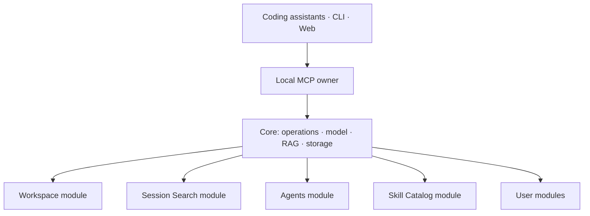

<p align="center">
  
</p>

# Contextopus

**A modular system for reusing and improving context.** Prepare context once,
apply it across tasks and tools, and refine it as you work.

Context can include knowledge, instructions, skills, reusable commands, agent
roles and session descriptions. Contextopus helps people and agents find relevant
material, read it and adapt it to the task. Reuse reduces repeated research,
generation and explanations from the user. Saved context can be corrected,
connected and gradually improved.

**Core provides the shared foundation:** storage, indexing, semantic search,
filtering, settings and one MCP service for connected agents. Each module defines
its own materials and ways of working with them. Modules share an embedding model
and search infrastructure while keeping separate databases, so a new module does
not need to build its own retrieval system.

- **Workspace organizes project work.** Agents use current knowledge, goals and
  rules, carry out tasks, verify results and update the connected context. Each
  task can build on decisions and findings from earlier work. With Workspace
  1.6+, several sessions can work on the same context at once, reserving cards
  while editing so their changes do not overwrite one another.
- **Session Search makes past sessions reusable.** Find decisions, commands,
  errors and explanations with links to the original conversation. Recover how
  work was done, check where a decision came from and use the findings in a new
  task.

Skill Catalog organizes installed skills and records verified aliases, overlapping functionality and source locations. Choose the modules that fit your work.

<p align="center">
  <a href="#install-contextopus"><strong>Install Contextopus</strong></a> ·
  <a href="#choose-your-modules">Ecosystem</a> ·
  <a href="#connect-a-coding-assistant">Coding assistants</a> ·
  <a href="docs/modules.md">Build a module</a> ·
  <a href="docs/development.md">Development</a>
</p>

> **Version 1.8.0** makes procedure inputs precise, protects Workspace changes against revised assignments, and shows contexts with their linked rules in the Library.
> [Release downloads](https://github.com/pikiby/contextopus-core/releases/tag/v1.8.0) · [Installation guide](distribution/README.md).

## Choose your modules

### Core

**One foundation across tools.** Connect your coding assistants and terminal to
one local context service. Modules share a model and retrieval infrastructure,
giving project knowledge and session history a common route into your tools.
Choose the modules that fit your work and use them across clients.

[Core repository](https://github.com/pikiby/contextopus-core) ·
[Architecture](docs/architecture.md) · [Build a module](docs/modules.md)

### Workspace

**Make project knowledge improve with the work.** Workspace gives the agent a
procedure for building and maintaining a growing vector knowledge base: find
relevant knowledge, work under your rules, verify the result, then update,
merge and link what belongs in the project's memory.

Knowledge stays in readable, linked Markdown and is indexed for semantic
search. Updates follow your review and approval policies. As verified findings
are corrected and connected, new tasks can use a better account of what is
known and what still needs checking.

**Work in parallel on one shared context (Workspace 1.6+).** Give several sessions
different tasks on the same project. Each keeps its own work cycle while using
the same knowledge and rules. Agents temporarily reserve the cards they edit;
other sessions can keep reading, searching and updating other cards. Revision
checks reject outdated edits before they overwrite newer work.

[Workspace repository and guide](https://github.com/pikiby/contextopus-workspace#readme)

### Session Search

**Find past work by meaning.** Search agent-maintained session descriptions across
coding assistants, filtered by source, project, context, tags and work status.
Cards are Markdown with YAML and links to original sessions and related knowledge.
Update them explicitly with a skill or through your working instructions; no
transcript watcher, timer or bulk conversation embeddings are required.

[Session Search repository and guide](https://github.com/pikiby/contextopus-session-search#readme)

### Skill Catalog

**Find and organize the skills you already have.** Register their locations, describe
them in linked Markdown and search by meaning or installation metadata. Compare
overlapping skills and record verified aliases without changing source packages.
The module does not synchronize skills between clients.

[Skill Catalog repository and guide](https://github.com/pikiby/contextopus-skills#readme)

### Agents

**Reuse the right agents for each task.** Save complete role prompts and model
settings in Markdown, group profiles into named teams, and define delegation
rules for your main agent. Find a profile by meaning, read it in full and use your
coding assistant's native subagent tools. Profile files and rules remain editable;
shared RAG helps discover them without duplicating a search service.

[Agents repository and guide](https://github.com/pikiby/contextopus-agents#readme)

<a id="start-from-source"></a>

## Install Contextopus

### Choose your coding assistant

Download a [release package](https://github.com/pikiby/contextopus-core/releases/tag/v1.8.0) for your platform. The distribution provides a separate installation package for **Codex,
Claude Code, Cursor, Hermes, OpenCode and Crush**. Each uses the same Core installer
and persistent data folder. Claude Code, Cursor, Codex and Hermes packages include
plugin skills and MCP configuration; OpenCode and Crush use native file integration.

Extract your client package and run `sh install.sh` on Linux/macOS or
`powershell -File install.ps1` on Windows. Review the data folder, modules and model
setup. An existing Core is reused; a fresh installation can obtain Python through uv.
Reload your client and verify a real MCP read.

Package and integration tests do not establish compatibility with every client version.
[Package formats and verification limits](docs/client-packages.md).

### Choose your modules

Install Core alone or select bundled modules with `--module ID`; use
`--module none` for Core only. Defer embedding downloads with `--skip-model`.
Semantic search requires completing model setup later.

For an existing Core, install a verified module through its normal lifecycle:

```console
contextopus modules install MODULE_ID --source /path/to/module.zip
```

[Installer details](distribution/README.md) · [Build from source](docs/development.md)

## Connect a coding assistant

**The starter configures the clients you select.** For an existing installation,
use the command for your client below. Each command prints its preview and applies
the configuration and available skills. To review without writing, omit `--apply`.

<details>
<summary>Codex</summary>

```console
contextopus integrate codex --user --apply
```

</details>

<details>
<summary>Claude Code</summary>

```console
contextopus integrate claude-code --user --apply
```

</details>

<details>
<summary>Cursor</summary>

```console
contextopus integrate cursor --user --apply
```

</details>

<details>
<summary>OpenCode</summary>

```console
contextopus integrate opencode --user --apply
```

</details>

<details>
<summary>Crush</summary>

```console
contextopus integrate crush --user --apply
```

</details>

<details>
<summary>Hermes</summary>

```console
contextopus integrate hermes --user --apply
```

</details>

Reload the client, then ask:

> Use Contextopus to list my installed modules and read the guide for getting started.

Keep one data root across clients. If you add a module later, repeat integration
to deliver its skills. User-edited skills are protected. Hermes profiles and
project-scoped connections are covered in the
[connection guide](docs/integrations.md) and
[Hermes guide](docs/integrations/hermes.md).

## How the pieces fit



One Core process owns shared resources. Every module owns its domain schema and
data; SQL lives in `core/storage/modules/MODULE_ID.sqlite3`. Replaceable module
code stays separate from mutable data and configuration. Discovery reads manifests;
explicit install/update actions prepare dependencies and migrations. Disable
removes the contribution while retaining data.

The web library displays enabled modules and searchable records. CLI and MCP expose status, settings and module controls.
[Architecture](docs/architecture.md) · [Module lifecycle and SDK](docs/modules.md) ·
[Search selection](docs/search-selection.md).

## Development and documentation

Core builds and tests from this repository alone. Module repositories own their
module tests and artifacts; cross-repository checks take explicit Core/module
inputs. Core's wheel contains the `modules` entrypoint. Client packages also include skills from their explicitly bundled modules.

- [Build, tests and installed-wheel verification](docs/development.md)
- [Architecture and data layout](docs/architecture.md)
- [Module contract and examples](docs/modules.md)
- [Local read-only web library](docs/web-interface.md) — run `contextopus web` to browse enabled modules.
- [Native integrations](docs/integrations.md)
- [Search evidence](docs/search-analysis.md)
- [Published release history](CHANGELOG.md)

The configured CI matrix targets Python 3.12/3.13 on Linux, macOS and Windows.
A passing source test does not establish a published artifact, an updated live
installation or compatibility with every client version.

## License

[Apache License 2.0](LICENSE). See [NOTICE](NOTICE) for attribution.

## Current release

[1.8.0: Reliable procedures and context rules](docs/releases/1.8.0.md) · [Downloads](https://github.com/pikiby/contextopus-core/releases/tag/v1.8.0)
