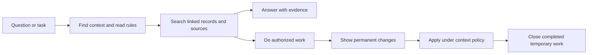
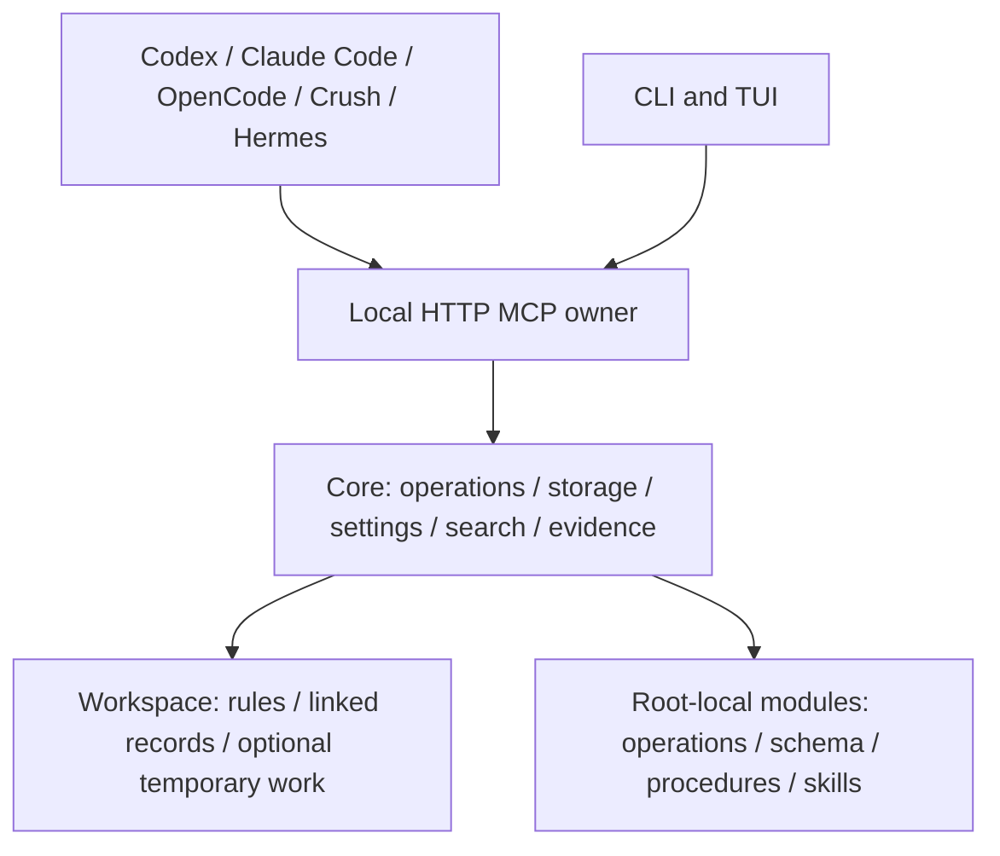

<p align="center">
  
</p>

# Contextopus

Persistent project memory for people and coding agents. Keep decisions, goals,
tasks, source references and working rules outside a chat, then find and update
them from your terminal or coding assistant.

A Workspace gives a project its own instructions and linked Markdown records.
Contextopus searches those records, explains result selection, prepares reviewable
changes and keeps history. The terminal interface and coding clients use one
shared Core and local MCP service, so they work with the same data.


**EXAMPLE:** actual Textual render with synthetic data.
[Keyboard settings demo](docs/media/tui/settings-demo.gif) ·
[Narrow terminal](docs/media/tui/main-narrow.png) ·
[Capture method and limits](docs/media/tui/README.md).

**1.4.0** adds optional shared working memory in `.tmp`, dependency-aware cleanup,
context tags, portable context names and native Hermes support alongside Codex,
Claude Code, OpenCode and Crush. [Changes from 1.3.3 and upgrade guide](docs/releases/1.4.0.md).

## Quick start

Install [uv](https://docs.astral.sh/uv/getting-started/installation/) and obtain the
matching wheel and `SHA256SUMS` from the project's
[release assets](https://github.com/pikiby/contextopus-core/releases). Verify the
wheel's SHA-256 before installation. The commands below use the local embedding
extra; choose an actual persistent data directory instead of the example path.

```console
uv tool install --python 3.12 "./contextopus_core-1.4.0-py3-none-any.whl[local]"
contextopus --version
contextopus root --set /absolute/path/to/contextopus-data
contextopus init
contextopus setupmodel
contextopus setupmodel --apply
contextopus tui
```

`init` installs the user service and prepares Core. A first initialization without
an embedding profile reports `model_setup_required`; `setupmodel` previews the
profile and device, and `--apply` performs the reviewed setup and index rebuild.
Local weights download only when an explicit setup or inference action needs
them. The base wheel without `[local]` also supports an explicitly configured API
embedding profile. [Model setup](docs/architecture.md#explicit-embedding-setup).

You can ask an agent to do the installation using the same documented steps:

> Install Contextopus from this verified 1.4.0 wheel with local embeddings. Use
> `/absolute/path/to/contextopus-data` as the persistent root, connect Codex at
> user scope, show configuration changes, then verify a real context read.

Keep one data root across clients. `--root <directory>` before a subcommand or
`CONTEXTOPUS_ROOT` overrides the persistent root binding. An existing installation
needs the [upgrade and recovery sequence](docs/releases/1.4.0.md#upgrade), preserving
its root, inference extras, custom rules and unfinished work.

## Connect your coding assistant

Native adapters install short skills and an HTTP MCP entry. Preview the paths,
then apply the reviewed configuration:

```console
contextopus integrate codex --user
contextopus integrate codex --user --apply
contextopus service status
```

Other adapter names are `claude-code`, `opencode`, `crush` and `hermes`.
Codex, Claude Code, OpenCode and Crush also support `--project <directory>`.
Hermes uses its native user or profile
home: `contextopus integrate hermes --user --hermes-home <directory>`.
Use `contextopus service start` if the shared owner is stopped, then reload your
client and verify a real Contextopus read.

| Client | Native entry for a read-only request |
|---|---|
| Codex | `$w-search In release-tools, find the retry-policy decision and read its linked evidence.` |
| Claude Code | `/w-search In release-tools, find the retry-policy decision and read its linked evidence.` |
| OpenCode 1.18.32 | `opencode run --command w-search "In release-tools, find the retry-policy decision and read its linked evidence."` |
| Crush | Ask: `Use the w-search skill in release-tools to find the retry-policy decision and read its linked evidence.` |
| Hermes | `/w-search In release-tools, find the retry-policy decision and read its linked evidence.` |

Skill activation differs between clients and versions. Other MCP clients can
connect manually when they support Streamable HTTP and the required permissions;
they do not receive a native Contextopus adapter automatically.
[Connection paths, invocation details and recovery](docs/integrations.md) ·
[Hermes homes and profiles](docs/integrations/hermes.md).

## From question to saved result



| Need | Example request |
|---|---|
| Resume a project | `Use w in release-tools: continue the existing packaging task and save the verified result.` |
| Track a goal and its tasks | `Use w: record the rollout goal, link its verification task and the deployment decision.` |
| Keep facts tied to current sources | `Use w: update the API limit from the official reference and declare what must be rechecked.` |
| Hand work to another agent | `Use w: retain the shared test inputs and findings for the next agent; keep unfinished work open.` |
| Investigate an earlier run | `Use w-analyze: inspect yesterday's release-tools search failures using the rules in force then.` |
| Review project rules | `Use w-settings in release-tools: show the proposed instructions change before applying it.` |

Use `w-create` to explicitly create a Workspace and agree its rules/settings;
`w-context` finds an existing context by name, path or meaning. Prefix skill names
as your client requires. [Walk through these scenarios](docs/usage.md).

Records have stable YAML IDs, descriptive filenames, types such as `project`,
`goal`, `task` or `decision`, optional status, descriptions and Obsidian-compatible
links. Required source references
tell the agent what to obtain freshly before relying on a dependent fact.
Permanent changes follow the selected context's review and approval policy.
Optional `.tmp` cards hold reusable assignments, inputs and intermediate findings;
direct answers and small knowledge corrections need no temporary report.

Search inherits the context's algorithm and limits. Diagnostics distinguish
relevance boundaries, result/candidate caps and unindexed material. Git can keep
permanent record and settings versions; SQLite journals retain operation and
search evidence for bounded analysis. These records establish what ran and what
was saved, with explicit limits on claims about model behavior.

## One Core, several interfaces



The TUI shows service state, storage metrics, search/model settings and modules.
`contextopus status`, `contextopus settings` and `contextopus modules` expose the
same shared operations from the command line. There is no separate TUI data store.


**EXAMPLE:** existing 1.2 search-selection capture with synthetic data, inherited
values, a pending algorithm choice and revision preview.
[Modules screen](docs/media/tui/modules-1.2-wide.png).
These captures render the actual TUI; they do not show a live installation.

Put a trusted module package in `<root>/modules/<id>` and install it through `m`,
`contextopus modules install <id>` or the TUI Modules page. Its manifest declares
operations, dependencies and any SQLite schema migrations. Core prepares the
package, applies declared migrations and enables the operations; user data and
configuration remain separate from replaceable package code. Modules can also
contribute procedures, skills and search algorithms.
[Module installation and authoring](docs/modules.md).

## Documentation and verification

- [Usage and concrete scenarios](docs/usage.md)
- [Native clients and manual MCP connections](docs/integrations.md)
- [Architecture and data layout](docs/architecture.md)
- [Search algorithms and settings](docs/search-selection.md)
- [Search evidence and analysis](docs/search-analysis.md)
- [Base documentation context](docs/base-context.md)
- [1.4.0 changes and migration](docs/releases/1.4.0.md)
- [1.4 implementation and local verification](docs/implementation/contextopus-1.4.md)
- [Hermes acceptance evidence and limits](docs/implementation/hermes-integration.md)
- [Changelog](CHANGELOG.md)

The CI matrix covers Python 3.12/3.13 on Linux, macOS and Windows. Native-client,
OS startup and model-driven checks have their own versioned evidence; a passing
package test does not establish universal client compatibility.
The client ZIPs contain skills and instructions; the wheel installs the runtime.

## License

Licensed under the [Apache License 2.0](LICENSE). See [NOTICE](NOTICE) for attribution.
