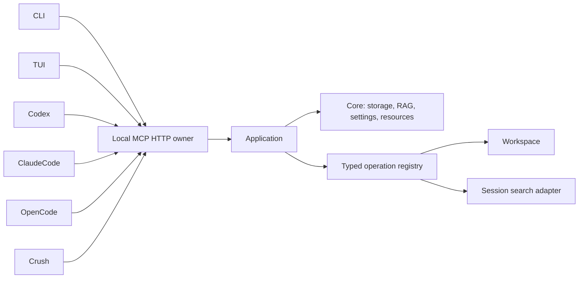

# Contextopus architecture

One installed Python runtime owns model/provider pools and database resources. CLI, TUI and coding clients use the same Application operations through the local owner. Import, status and procedure reads do not download or load an embedding model. Local embeddings are an explicit installation extra; existing Qwen3-Embedding-0.6B profiles remain Workspace configuration.

Persistent data belongs in an explicit root or the platform's user-data directory, outside plugin caches. Root configuration, RAG and analytics have separate paths. Workspace is a module with selected project rules, task state, temporary work and reviewed permanent knowledge. Core is independent of Workspace rules. Legacy operations are compatibility aliases; namespaced module operations are preferred.

| Component | Scope |
|---|---|
| Core | Storage, typed operations, shared lifetime, settings and relocation |
| Workspace | Persistent project knowledge and explicit work cycles |
| MCP | Query/execute transport and canonical procedure retrieval |
| CLI/TUI | Thin views and controls over shared operations |
| Session search | Optional adapter to an independently installed session indexer |
| GraphFrontier | Future integration; no readiness claim |
| Skills registry | Proposed idea; not an implemented module |

Relocation copies files, checks a manifest, validates SQLite where applicable and leaves a receipt/redirect. Source deletion requires separate authorization. Settings previews identify consequences; saving does not silently reindex existing data.

Folder modules live under `modules/<id>/`: replaceable package code is separate from persistent data and configuration. Discovery reads manifests; explicit prepare/enable actions activate contributions to the common registry. Module operations, procedures, skills and filtering algorithms use the same Core contracts. See [module lifecycle](modules.md).

Search selection is a shared Core service. Algorithm descriptions and JSON schemas sit beside implementations; effective settings are resolved for the selected scope and may be overridden for one query. [Selection diagnostics](search-selection.md) explain cuts and limits. [Bounded search evidence](search-analysis.md) supports historical analysis without duplicating source bodies.

The [base documentation context](base-context.md) is an ordinary Workspace populated during explicit setup after model configuration. Its documentation role can point at another context. Reading it supplies reference material and never replaces the active context's instructions.

## Explicit embedding setup

`contextopus setupmodel --hardware` performs a PyTorch/CUDA/MPS diagnostic without loading weights. `contextopus setupmodel --device auto` previews validated provider/profile, chunking and device selection. Auto chooses an observed available CUDA device, then MPS, then CPU; an unavailable explicitly requested device fails. A GPU existing in a machine is not proof that this installed PyTorch can use it.

`--config provider-profile.json` and `--chunking chunking.json` select an explicit local or API configuration. API providers require a compatible explicit tokenizer; credentials are environment-variable references. `--apply` delegates to Core's atomic profile/index rebuild. It can download local weights or contact the selected API as disclosed in the plan. Existing profile dimensions, normalization and pinned revision are preserved unless explicitly changed. A stale preview or a GPU becoming unavailable fails before publication. Hardware and model setup are explicit actions; opening status does not install weights or run GPU diagnostics.

The device probe uses [PyTorch CUDA availability](https://docs.pytorch.org/docs/stable/generated/torch.cuda.is_available.html) and [MPS backend availability](https://docs.pytorch.org/docs/stable/backends.html). Model inference remains a separate verification result.

## Windows relocation exclusion

The Windows protocol holds the root advisory guard continuously, acquires legacy locks to exclude active supported operations, and publishes the durable freeze before closing nested file handles for the directory rename. Supported Contextopus Windows engines enter this same root guard and reject a frozen/relocated source; they cannot write during the close-to-rename interval. The POSIX protocol retains the legacy locks across rename. This contract does not protect against arbitrary programs that ignore the root guard/freeze and write directly to the filesystem. Older POSIX-only PCW engines were not supported Windows writers.

Windows directory-renaming restrictions are documented in Microsoft's [FILE_RENAME_INFORMATION remarks](https://learn.microsoft.com/en-us/windows-hardware/drivers/ddi/ntifs/ns-ntifs-_file_rename_information).

## Workspace records (format 4)

`modules/workspace/workspace_contexts/<context>/INSTRUCTIONS.md` owns that context's complete free-text rules. Machine policies use the existing Core configuration hierarchy, with migrated context values in `core/configuration/contexts/workspace/<context>.json`. `knowledge/*.md` contains all permanent record types. YAML `id` is the stable identity used by the API; on-disk YAML links are quoted Obsidian wikilinks to real vault paths. Descriptive filenames can change. `type` is open vocabulary (`knowledge`, `task`, `goal`, `project`, `decision` are examples); `status` is optional. Plans and goals remain intentions until evidence establishes completion.

The project description is one indexed `type: project` record. Tasks use the same read/search/proposal/link/history operations. There is no separate Current or mutable duplicate PROJECT file. `tmp/<cycle>/` holds temporary results and exact pending proposals; cleanup still follows result review and the selected approval policy. Custom instructions are not silently replaced by new defaults.

RAG belongs to Core. Context, type and status predicates narrow eligible records before vector top-N. Cross-context retrieval supplies evidence, not another context's rules. `workspace.contexts` lists actual directories, `workspace.project_read` reads one selected project, `workspace.projects_search` searches indexed project records and returns bounded excerpts. Discovery starts no work cycle and creates nothing.

Migration snapshots sources/control, moves legacy Current fields and PROJECT into records, extracts only known machine policy keys from instruction frontmatter into Core configuration, converts native navigation links, reconciles the shared index, then marks format 4 complete. The remaining instruction text and user frontmatter retain their original bytes. Original pending proposal text/digests remain immutable; technical execution overlays adapt paths and metadata without granting approval. A legacy instruction proposal that changes machine settings requires a separate settings review and renewed instruction preparation. Interrupted transitions reuse their receipt. Git tracks permanent records, rules and historical settings; tmp, indexes and service state stay outside memory history.

### Record provenance in Git

Workspace proposes Git history in the standard creation settings. Reviewed transformations describe merge/split/replacement edges between stable record IDs. Their before/after paths and fingerprints, summary and cycle/operation are captured with the permanent snapshot and stored in ordinary Git commit trailers. Git parents provide version ordering; declared transformations provide material ancestry. Native Git query operations filter by ID/path/date/message, search removed text, describe commits and read bounded diffs or old records. Old commits without declarations remain navigable by path/text and are explicitly marked as lacking provenance.

### Workspace settings history

Machine policies live in Core configuration at
`core/configuration/contexts/workspace/<context>.json`; `INSTRUCTIONS.md` keeps the
complete free-form user rules. The Git-only path `.contextopus-settings.json`
records effective settings and their origins. It has no live worktree copy, and
the Git index marks it `skip-worktree`. History read, diff and search accept that
path. Durable previews and apply receipts live in the Workspace control directory
under `settings/`; retries retain the exact approved revision. Settings writes and
pending Git commits have separate outcomes. Disabling history still records the
final change under the prior policy.

New analytics events retain a separate settings basis in
`instructions_ref.settings_revision` and `instructions_ref.settings_ref`, plus a
Git reference with `role: workspace_settings`. The free-text instruction revision
retains its own meaning. Analysis distinguishes settings eras even when that
instruction revision is unchanged. Missing historical settings remain unknown;
today's configuration never supplies a replacement. Settings-only observations
do not read the instructions and mark that part of their basis unknown.

### Operation evidence and analysis

SQLite journals record calls, parameters, result/error metadata, durations and references. Git remains the authority for permanent content versions; exact commit/blob references require matching captured content. Dirty or unversioned observations expose their replay limits. Historical retained blobs and unmatched evidence are preserved rather than discarded on an assumption that Git covers them. Drafts and imported host messages remain distinct evidence.

A derived SQLite history index supports bounded commit/version indexing and context-qualified lineage graphs from declared Git transformation trailers. It is rebuildable, and declarations do not prove semantic correctness. The `w-analyze` skill loads the canonical MCP analysis procedure: finite context/question/time/filter scope, progressive metadata selection, exact events, then Git versions/diffs. Reports state coverage and contemporaneous instruction/runtime evidence; unknown historical rules cannot support retrospective judgments. Reads do not prove actual model use, and performance or token savings require host usage and comparable control runs. Explicitly retained assessments are separate from objective events and knowledge.
