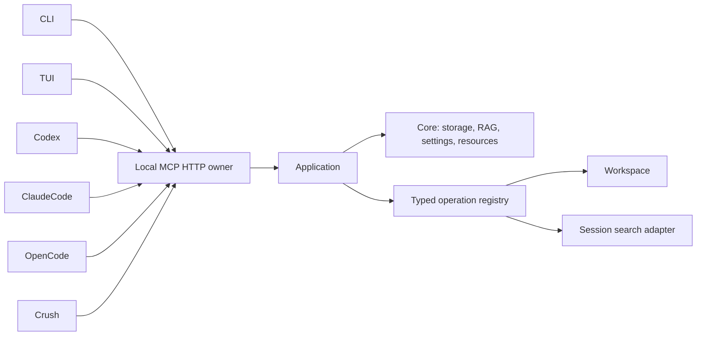

# Contextopus architecture

One installed Python runtime owns model/provider pools and database resources. CLI, TUI and coding clients use the same Application operations through the local owner. Import, status and procedure reads do not download or load an embedding model. Local embeddings are an explicit installation extra; existing Qwen3-Embedding-0.6B profiles remain Workspace configuration.

Persistent data belongs in an explicit root or the platform's user-data directory, outside plugin caches. Root configuration, RAG and analytics have separate paths. Workspace is a module with selected project rules, task state, temporary work and reviewed permanent knowledge. Core is independent of Workspace rules. Legacy operations are compatibility aliases; namespaced module operations are preferred.

| Component | Scope |
|---|---|
| Core | Storage, typed operations, shared lifetime, settings and relocation |
| Workspace | Persistent project knowledge and explicit work cycles |
| MCP | Query/execute transport and canonical procedure retrieval |
| CLI/TUI | Thin views and controls over shared operations |
| Session search | Optional adapter to an independently installed session indexer |
| GraphFrontier | Future integration; no readiness claim |
| Skills registry | Proposed idea; not an implemented module |

Relocation copies files, checks a manifest, validates SQLite where applicable and leaves a receipt/redirect. Source deletion requires separate authorization. Settings previews identify consequences; saving does not silently reindex existing data.

## Explicit embedding setup

`contextopus setupmodel --hardware` performs a PyTorch/CUDA/MPS diagnostic without loading weights. `contextopus setupmodel --device auto` previews validated provider/profile, chunking and device selection. Auto chooses an observed available CUDA device, then MPS, then CPU; an unavailable explicitly requested device fails. A GPU existing in a machine is not proof that this installed PyTorch can use it.

`--config provider-profile.json` and `--chunking chunking.json` select an explicit local or API configuration. API providers require a compatible explicit tokenizer; credentials are environment-variable references. `--apply` delegates to Core's atomic profile/index rebuild. It can download local weights or contact the selected API as disclosed in the plan. Existing profile dimensions, normalization and pinned revision are preserved unless explicitly changed. A stale preview or a GPU becoming unavailable fails before publication. Hardware and model setup are explicit actions; opening status does not install weights or run GPU diagnostics.

The device probe uses [PyTorch CUDA availability](https://docs.pytorch.org/docs/stable/generated/torch.cuda.is_available.html) and [MPS backend availability](https://docs.pytorch.org/docs/stable/backends.html). Model inference remains a separate verification result.
