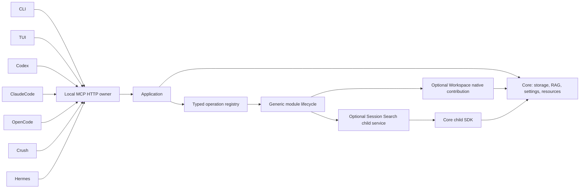

# Contextopus architecture

One installed Core Python runtime owns model/provider pools, shared RAG and database services. CLI, TUI and coding clients use the same Application operations through the local owner. Import, status and procedure reads do not download or load an embedding model. Local embeddings are an explicit installation extra; provider/profile selection belongs to Core and is shared by enabled modules.

Persistent data belongs in an explicit root or the platform's user-data directory, outside plugin caches. Root configuration, RAG and analytics have separate paths. Workspace is an optional module with selected project rules, task state, temporary work and reviewed permanent knowledge. Its code, reference documents, domain rules and skills live in the separate module package. The Core wheel supplies infrastructure and the `m` module-management skill; it does not register or migrate Workspace on startup. Legacy operations are compatibility aliases; namespaced module operations are preferred.

| Component | Scope |
|---|---|
| Core | Storage, typed operations, shared lifetime, settings and relocation |
| Workspace | Optional native contribution for project knowledge and explicit work cycles |
| MCP | Query/execute transport and canonical procedure retrieval |
| CLI/TUI | Thin views and controls over shared operations |
| Session search | Optional child service using Core SQL, embeddings and RAG; a compatibility adapter can expose an existing standalone installation |
| GraphFrontier | Future integration; no readiness claim |
| Skills registry | Proposed idea; not an implemented module |

Relocation copies files, checks a manifest, validates SQLite where applicable and leaves a receipt/redirect. Source deletion requires separate authorization. Settings previews identify consequences; saving does not silently reindex existing data.

Each new relocation keeps its original SQLite bytes and sidecars in
`.backups/relocations/<snapshot-id>/`, with the identity retained across retries.
Existing snapshot trees, including legacy `core/relocation/raw/`, are copied
byte-for-byte as archives, not opened or snapshotted again as live databases.
Previously saved relocation plans and receipts retain their original paths.

Folder modules live under `modules/<id>/`: replaceable package code is separate from persistent data and configuration. Discovery reads manifests. Explicit installation prepares dependencies and module-owned migrations, checks readiness and publishes contributions to the common registry. Workspace and Session Search use these same lifecycle operations. Native contributions run in the Core interpreter; persistent child services use its bounded SQL/embedding/RAG SDK. Enablement and release fingerprints persist across owner restarts, and other Applications reconcile changes before dispatch. Disable removes owned operations, settings, procedures, skills and source adapters while retaining data. Native cleanup drains admitted calls; errors do not skip the remaining Core resource cleanup. See [module lifecycle](modules.md).

Structured module data uses one Core-owned SQLite file per module under
`core/storage/modules/`. Core coordinates writers and transactions; modules own
their schemas and domain migrations. A model/provider and the vector index are
shared at the root. SQL and RAG commits are independent, so background modules
use durable jobs and deletion outboxes for replay rather than assuming one
transaction covers both stores.

Search selection is a shared Core service. Algorithm descriptions and JSON schemas sit beside implementations; effective settings are resolved for the selected scope and may be overridden for one query. [Selection diagnostics](search-selection.md) explain cuts and limits. [Bounded search evidence](search-analysis.md) supports historical analysis without duplicating source bodies.

The [base documentation context](base-context.md) is an ordinary Workspace populated during explicit setup after model configuration. Its documentation role can point at another context. Reading it supplies reference material and never replaces the active context's instructions.

## Explicit embedding setup

`contextopus setupmodel --hardware` performs a PyTorch/CUDA/MPS diagnostic without loading weights. `contextopus setupmodel --device auto` previews validated provider/profile, chunking and device selection. Auto chooses an observed available CUDA device, then MPS, then CPU; an unavailable explicitly requested device fails. A GPU existing in a machine is not proof that this installed PyTorch can use it.

`--config provider-profile.json` and `--chunking chunking.json` select an explicit local or API configuration. API providers require a compatible explicit tokenizer; credentials are environment-variable references. `--apply` delegates to Core's atomic profile/index rebuild. It can download local weights or contact the selected API as disclosed in the plan. Existing profile dimensions, normalization and pinned revision are preserved unless explicitly changed. A stale preview or a GPU becoming unavailable fails before publication. Hardware and model setup are explicit actions; opening status does not install weights or run GPU diagnostics.

The device probe uses [PyTorch CUDA availability](https://docs.pytorch.org/docs/stable/generated/torch.cuda.is_available.html) and [MPS backend availability](https://docs.pytorch.org/docs/stable/backends.html). Model inference remains a separate verification result.

## Windows relocation exclusion

The Windows protocol holds the root advisory guard continuously, acquires legacy locks to exclude active supported operations, and publishes the durable freeze before closing nested file handles for the directory rename. Supported Contextopus Windows engines enter this same root guard and reject a frozen/relocated source; they cannot write during the close-to-rename interval. The POSIX protocol retains the legacy locks across rename. This contract does not protect against arbitrary programs that ignore the root guard/freeze and write directly to the filesystem. Older POSIX-only PCW engines were not supported Windows writers.

Windows directory-renaming restrictions are documented in Microsoft's [FILE_RENAME_INFORMATION remarks](https://learn.microsoft.com/en-us/windows-hardware/drivers/ddi/ntifs/ns-ntifs-_file_rename_information).

## Module-owned formats and workflows

Workspace owns linked Markdown records, complete project instructions, approval
policies, work cycles and format migration. See the
[Workspace architecture](https://github.com/pikiby/contextopus-workspace/blob/main/docs/architecture.md)
for record formats, Git provenance, settings history and domain analytics.
Session Search owns transcript ingestion, deduplication and its durable indexing
queue; see its [module documentation](https://github.com/pikiby/contextopus-session-search).

Core coordinates the shared model, vector store, operation journal and per-module
SQL services. The domain implementations are not bundled into Core artifacts.
