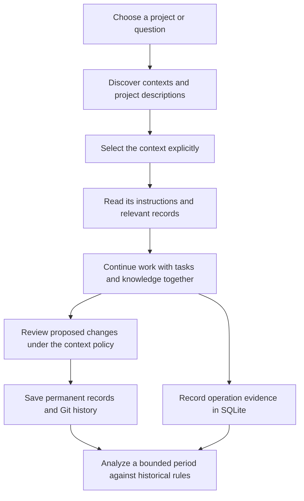

# Contextopus 1.1.0

Contextopus 1.1.0 brings project descriptions, tasks and knowledge into one searchable record system. Find the right project before opening its context, continue unfinished work, and inspect an agent's recorded actions against the instructions that applied at the time.

[All changes since 1.0.0](https://github.com/pikiby/contextopus-core/compare/v1.0.0...v1.1.0) · [Download release assets](https://github.com/pikiby/contextopus-core/releases/tag/v1.1.0)

## Projects, tasks and knowledge together

Workspace format 3 stores project descriptions, tasks, goals, decisions and knowledge as Markdown/YAML records with stable IDs. They share search, links, reviewed proposals and history. Types are open vocabulary; optional context, type and status filters narrow eligible records before vector search selects its top results.

Project discovery lists existing contexts or searches indexed project descriptions with bounded excerpts. Discovery does not switch a session's selected context. Format upgrades move the former PROJECT and Current content into records while preserving IDs, links, custom instructions, tmp, active tasks, immutable pending proposals and approval state. Interrupted upgrades resume from their recorded snapshots; conversion does not approve, apply or cancel unfinished work.



## Six short skills

The native skills load full procedures from the installed MCP service, keeping client entrypoints small and consistent.

| Skill | Purpose |
|---|---|
| `w` | Continue work; route upgrade, audit and rework requests |
| `w-find` | Find a context by name, path or meaning |
| `w-search` | Read and search without starting a work cycle |
| `w-create` | Create an explicitly requested context |
| `w-settings` | Review a requested instructions change |
| `w-analyze` | Analyze actual operations and their historical instruction basis |

Integration updates recognized managed skills and preserves user-modified or unrecognized files, reporting collisions instead of overwriting them. Bare skill names and namespaced plugin skills are separate delivery choices; use one chosen integration mode.

## MCP service and client recovery

CLI and TUI can start, stop and restart the MCP owner independently of a working MCP connection. Native user-service definitions support systemd, macOS launchd and Windows Task Scheduler login startup and failure restart.

Codex recovery uses its existing app-server proxy. OpenCode recovery inspects the running server's OpenAPI. Claude Code and Crush receive client-specific recovery guidance. Reload the actual client and verify its MCP connection after an update: writing configuration or passing a Python test does not establish that a loaded client has reconnected.

## Git history and bounded analysis

New contexts offer standard settings with local Git history enabled; existing explicit settings and restrictive legacy defaults remain intact. Permanent record snapshots carry stable IDs, summaries and declared merge/split/replacement relationships in ordinary Git commit trailers. Bounded queries find relevant commits, deleted text, versions and diffs. Older commits remain accessible without invented transformation provenance.

SQLite records operation parameters, outcomes, durations and version references. Git remains the permanent-content authority, with a rebuildable SQLite index for versions and declared lineage. New observations reference matching Git content instead of copying every permanent file around each call. Dirty or unversioned text exposes replay limits; legacy evidence without a proven Git match is retained.

`w-analyze` first establishes the context, question, dates and filters. Without dates or an explicit task, cycle or import, it uses the preceding seven days with a frozen upper boundary. It progressively selects exact events and historical Git versions, records coverage, and distinguishes instruction/runtime eras. Unknown historical rules stay unknown. Reading a record does not establish model use, and the journal alone cannot establish token savings or causal performance improvements. Retaining an assessment is an explicit action separate from changing knowledge.

## Install or update

Install [uv](https://docs.astral.sh/uv/getting-started/installation/), download the wheel and `SHA256SUMS` from this release, and verify the wheel's SHA-256 digest against that manifest. Run from the download directory:

```console
uv tool install --python 3.12 ./contextopus_core-1.1.0-py3-none-any.whl
contextopus --version
```

For an existing installation, replace the install command with:

```console
uv tool install --force --python 3.12 ./contextopus_core-1.1.0-py3-none-any.whl
```

Local embedding inference is optional. When needed, use the same command with `"./contextopus_core-1.1.0-py3-none-any.whl[local]"`, retaining `--force` for an update. Python and dependencies are managed by uv. This release distributes verified GitHub assets; it does not assume a PyPI publication.

Keep the existing data root: pass `--root <existing-data-root>` before commands or retain `CONTEXTOPUS_ROOT`/the saved root binding. Restart the service so it loads the updated runtime:

```console
contextopus --root <existing-data-root> service restart
contextopus --root <existing-data-root> service status
```

In a fresh client session, ask `w` to upgrade the existing installation, selected contexts and native skills. The [canonical upgrade procedure](https://github.com/pikiby/contextopus-core/blob/v1.1.0/src/contextopus/resources/procedures/upgrade.md) inspects unfinished work and preserved approvals before conversion. Existing users should follow that procedure on their existing root; `contextopus init` is for a new installation. Keep recovery snapshots and old caches until the upgrade is verified. Reload clients after integration changes and verify their connection to the intended root.

## Download contents and verification limits

The release contains:

- `contextopus_core-1.1.0-py3-none-any.whl`
- `contextopus_core-1.1.0.tar.gz`
- `contextopus-codex-1.1.0.zip`
- `contextopus-claude-code-1.1.0.zip`
- `contextopus-opencode-1.1.0.zip`
- `contextopus-crush-1.1.0.zip`
- `SHA256SUMS`

The CI matrix runs tests, builds, checksum/resource/skill verification, wheel installation and CLI version checks on Linux, macOS and Windows with Python 3.12 and 3.13. Platform-specific and optional-fixture skips remain visible in each job. These checks cover portable runtime and service-definition contracts; they do not prove native macOS or Windows login startup and crash recovery.

Native login/recovery verification is separate from CI, as are actual coding-client connection checks and model-driven workflows. A recovery test without a model turn does not establish end-to-end agent behavior. Real GPU inference depends on a separately verified environment. Session search requires its external compatible indexer; GraphFrontier integration and the skills registry remain future work.
